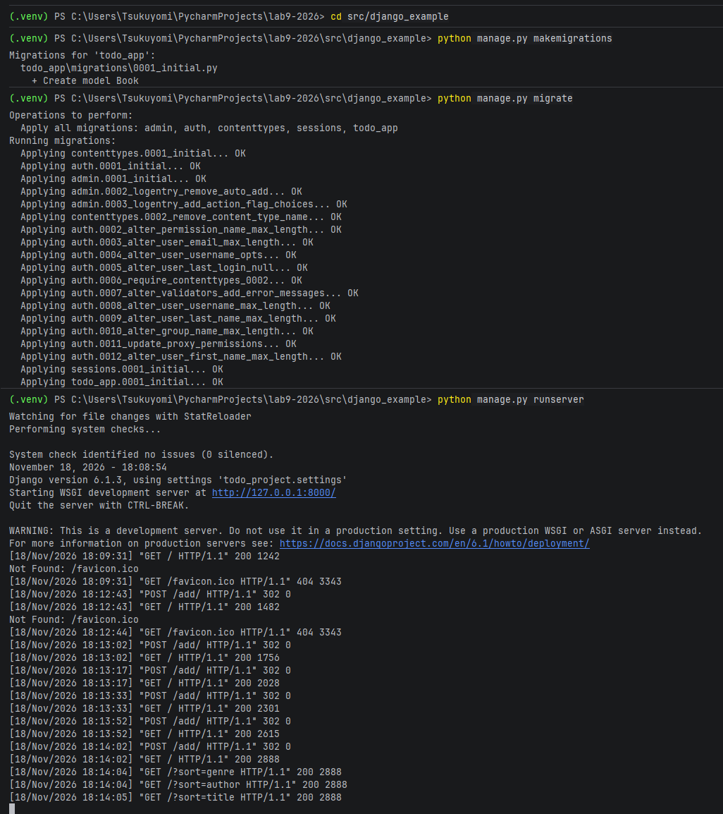
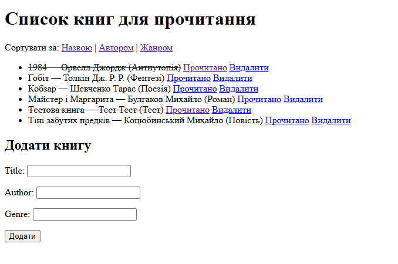
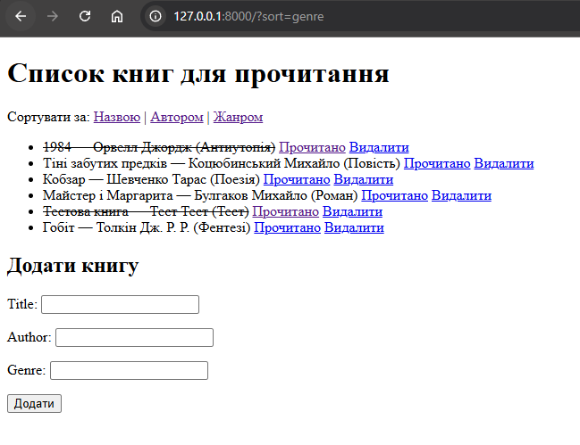
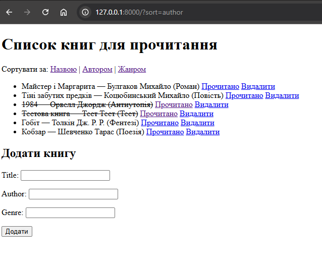

# Звіт до лабораторної роботи № 9

## Тема: Створення простого веб-додатку на Flask/Django

**Виконав:** Довгай Владислав
**Група:** ІСТ-25
**Номер варіанту:** 6

---

## Хід виконання

Для реалізації додатку було обрано фреймворк Django. 
Додаток створено на основі прикладу `src/django_example` (застосунок `todo_app`, проєкт `todo_project`).

### 1. Модель даних

У файлі `models.py` описано модель `Book` з полями: `title`, `author`, `genre` та `is_read`.

### 2. Форма, подання та маршрути

- `forms.py` - форма `BookForm` на основі `ModelForm` для додавання книги.
- `views.py` - подання `index`, `add_book`, `mark_read`, `delete_book`.
- `urls.py` - маршрути `/`, `/add/`, `/read/<id>/`, `/delete/<id>/`.
- `templates/todo_app/index.html` - шаблон зі списком книг, посиланнями сортування та формою додавання.

### 3. Міграції

Після зміни моделі було виконано команди `python manage.py makemigrations` та `python manage.py migrate`, які створили таблицю книг у базі даних.



### 4. Запуск сервера

Сервер розробки запущено командою `python manage.py runserver`, додаток доступний за адресою http://127.0.0.1:8000/.

### 5. Робота додатку







---

## Контрольне запитання

**Як би ви додали можливість сортування книг за автором або жанром?**

**Відповідь:**

У моделі `Book` уже є поля `author` та `genre`, тому сортування можна реалізувати на рівні запиту до бази даних, без зміни структури таблиці.

1. У поданні `index` зчитати параметр `sort` з рядка запиту (`request.GET.get('sort')`).
2. Перевіряти значення за списком дозволених полів (`title`, `author`, `genre`), щоб користувач не міг передати довільну назву поля. Якщо значення некоректне або відсутнє, використовується сортування за назвою.
3. Використовувати запит `Book.objects.order_by(sort)`.
4. У шаблоні додати посилання `?sort=author` та `?sort=genre`, які перезавантажують сторінку з відсортованим списком.

Фрагмент коду:

```python
SORT_FIELDS = {'title', 'author', 'genre'}

def index(request):
    sort = request.GET.get('sort', 'title')
    if sort not in SORT_FIELDS:
        sort = 'title'
    books = Book.objects.order_by(sort)
    ...
```

---

## Висновки

*Під час виконання лабораторної роботи я розробив веб-додаток «Список книг для прочитання» на фреймворку Django. Я навчився створювати модель даних і застосовувати міграції (`makemigrations`, `migrate`), використовувати `ModelForm` для обробки форм, писати подання та налаштовувати маршрутизацію, а також працювати з шаблонами Django (цикли, умови, тег ``, зворотний пошук URL через ``).*

*Додаток дозволяє переглядати список книг, додавати нові, позначати їх прочитаними, видаляти та сортувати за назвою, автором і жанром. Дані зберігаються в базі SQLite, тому не втрачаються після перезапуску сервера. Окремо я зрозумів, що без виконання `makemigrations` таблиця для нової моделі не створюється, а параметри сортування з рядка запиту необхідно перевіряти за списком дозволених значень.*
